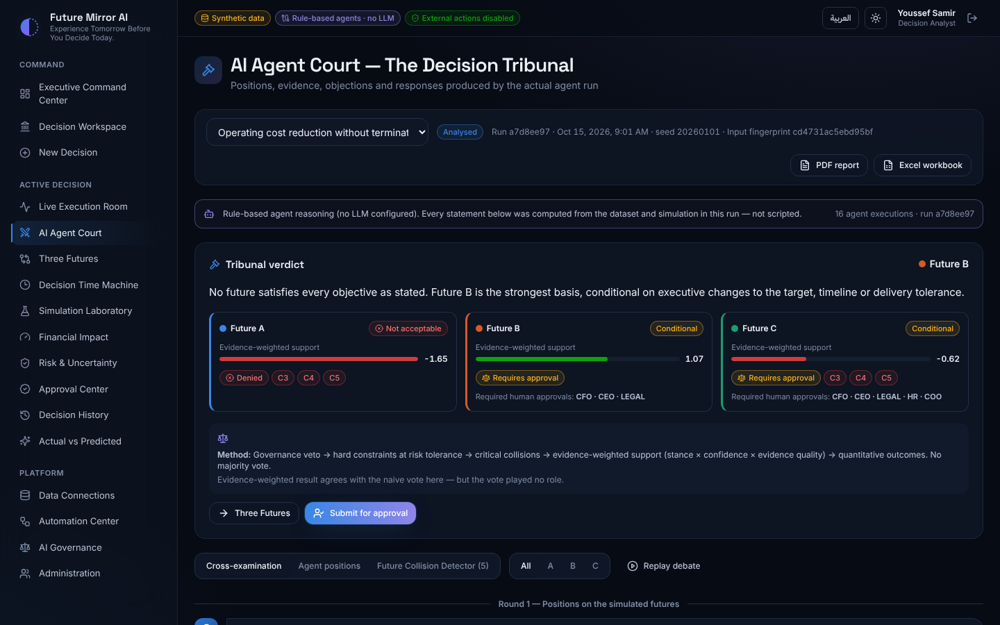

# Future Mirror AI

**Experience Tomorrow Before You Decide Today.**

Future Mirror AI is a decision-simulation platform for enterprises. You describe a strategic decision. Specialist AI agents analyse it independently and challenge each other in an **AI Agent Court**. Then a **quantitative simulation engine** that runs separately from the agents (Monte Carlo + SimPy) simulates three alternative futures. A **policy engine** that sits outside the AI decides what may proceed, and no strategy proceeds without the human approvals that policy requires.

> AI agents analyse and recommend. Humans decide. Policies are enforced outside the models.



## What is in this release (MVP — Enterprise Operating Cost Optimisation)

| Capability | Status |
|---|---|
| Decision intake wizard (EN/AR question parser, confirm-every-field) | ✅ working |
| 10 specialist agents + Chief Decision Orchestrator on **LangGraph** (parallel fan-out, retries, timeouts, cancellation, checkpointing) | ✅ working — rule-based reasoning by default, optional LLM narration (Anthropic / OpenAI / Ollama) |
| Live Execution Room (real Server-Sent Events, React Flow graph) | ✅ working |
| AI Agent Court (positions, evidence, Red Team objections, responses, verdict) | ✅ working |
| Future Collision Detector (structured rules over stances + simulation) | ✅ working |
| Three Futures with live slider recalculation | ✅ working |
| Simulation engine: monthly cost/capacity model, Monte Carlo (2 000 draws), sensitivity tornado, SimPy project-portfolio DES, constraint checks, feasibility search | ✅ working |
| Decision Time Machine (today → month 12, driven by the model's trajectories) | ✅ working |
| Governance engine (14 declarative policies, locked non-negotiables, sandbox) | ✅ working |
| Human approval workflow with separation of duties | ✅ working |
| Reality Feedback Loop (predicted vs actual, calibration diagnostics, candidate model that needs approval) | ✅ working |
| PDF / Excel executive reports in English and Arabic | ✅ working |
| Full Arabic / English UI with RTL, localised numbers | ✅ working |
| RBAC (8 roles, 19 permissions), JWT, tenant isolation, tamper-evident audit chain, emergency stop | ✅ working |
| Synthetic ERP connector, CSV/Excel import with reconciliation | ✅ working |
| Odoo XML-RPC adapter | ⚠️ implemented, **not verified** against a live Odoo instance |
| Dynamics 365 F&O and Business Central OData connectors, with a settings form | ⚠️ implemented and tested against mocked endpoints, **not verified** against a live tenant |
| SAP S/4HANA (OData), generic REST API and SQL database connectors, with settings forms | ⚠️ implemented; SQL verified end to end against PostgreSQL 16, SQL Server 2022 and MySQL 8.4, SAP/REST tested against mocked endpoints |
| n8n automation (dry-run, idempotency, approval gates, retries) | ✅ dry-run working; live delivery needs an n8n URL (`FM_N8N_BASE_URL`) |
| Docker Compose (PostgreSQL, API, nginx reverse proxy, optional n8n) | ✅ built and verified |

All demonstration data is **synthetic** and is labelled as synthetic everywhere in the UI and in reports.

## Quick start

### Option A — Docker (recommended)

```bash
cp .env.example .env          # optional; defaults work for a local demo
docker compose up -d --build
open http://localhost:8080
```

If your machine is behind a TLS-intercepting proxy, see [`DEPLOYMENT_GUIDE.md`](DEPLOYMENT_GUIDE.md#building-behind-a-proxy).

### Option B — local development

```bash
# backend (Python 3.12+)
cd backend
pip install -r requirements-dev.txt
uvicorn app.main:app --reload --port 8000        # SQLite by default; set FM_DATABASE_URL for PostgreSQL

# frontend (Node 20+)
cd frontend
npm install
npm run dev                                       # http://localhost:5173 (proxies /api to :8000)
```

On startup the API runs the Alembic migrations and seeds the demonstration workspace.

### Day-to-day operation scripts

The `ops/` folder has ready-made scripts. On Windows, double-click the `.bat` file. On macOS/Linux, run the `.sh` file from the project folder (for example `ops/start.sh`). They need Docker Desktop to be running.

| Task | Windows | macOS / Linux | What it does |
|---|---|---|---|
| Start | `ops\start.bat` | `ops/start.sh` | Starts the app (rebuilding it if the code changed, e.g. after `git pull`), waits until it is ready and opens http://localhost:8080 |
| Stop | `ops\stop.bat` | `ops/stop.sh` | Stops the app. Data is kept |
| Restart | `ops\restart.bat` | `ops/restart.sh` | Stops and starts the app (rebuilding if the code changed), e.g. after editing `.env` |
| Back up | `ops\backup.bat` | `ops/backup.sh` | Saves the database to `backups/fm_YYYYMMDD_HHMMSS.dump` (works while the app runs) |
| Restore | `ops\restore.bat [file]` | `ops/restore.sh [file]` | Lists the backups, asks which one, asks you to type YES, takes a safety backup, then replaces all data with the chosen backup |
| Update | `ops\update.bat` | `ops/update.sh` | Backs up, runs `git pull origin main`, rebuilds and restarts |

To back up automatically on Windows, create a daily task in Task Scheduler that runs `ops\backup.bat /nopause` (on macOS/Linux, a cron job running `ops/backup.sh`). The `backups/` folder is ignored by git. Copy it somewhere safe (another disk or cloud storage) to protect against losing the computer. Backups contain the database only. Keep your `.env` file safely as well, because it holds the database password and connector secrets.

### Demo accounts

All demo accounts share the password **`FutureMirror!2026`**.

| Email | Role |
|---|---|
| ceo@futuremirror.demo | CEO |
| cfo@futuremirror.demo | CFO |
| coo@futuremirror.demo | COO |
| legal@futuremirror.demo | General Counsel |
| hr@futuremirror.demo | HR Director |
| analyst@futuremirror.demo | Decision Analyst |
| admin@futuremirror.demo | Platform Administrator |
| viewer@futuremirror.demo | Viewer |

Follow [`DEMO_SCRIPT.md`](DEMO_SCRIPT.md) for the 8-scene guided demonstration.

## Tests

```bash
cd backend && pytest -q                                   # 56 unit, integration and security tests (SQLite)
FM_DATABASE_URL=postgresql+psycopg2://fm:fm@localhost/fm_test pytest -q   # the same suite on PostgreSQL
cd frontend && npx tsc --noEmit -p . && npm run build
cd frontend && npx playwright test                        # end-to-end demo (needs a running stack)
python scripts/perf_test.py http://localhost:8080        # performance smoke test
```

Results are in [`TEST_REPORT.md`](TEST_REPORT.md).

## Documentation

| Document | Contents |
|---|---|
| [ARCHITECTURE.md](ARCHITECTURE.md) | System design, technology decisions, trade-offs |
| [PRODUCT_REQUIREMENTS.md](PRODUCT_REQUIREMENTS.md) | Requirements and the **traceability matrix** |
| [AGENT_ARCHITECTURE.md](AGENT_ARCHITECTURE.md) | Agents, orchestration graph, court, collisions, recommendation method |
| [SIMULATION_MODEL.md](SIMULATION_MODEL.md) | Equations, distributions, calibration status, reproducibility |
| [GOVERNANCE_MODEL.md](GOVERNANCE_MODEL.md) | Policy engine, policies, approvals, authority limits |
| [DATABASE_DESIGN.md](DATABASE_DESIGN.md) | 35-table schema and traceability chain |
| [API_DOCUMENTATION.md](API_DOCUMENTATION.md) | REST + SSE API (OpenAPI at `/api/docs`) |
| [DEPLOYMENT_GUIDE.md](DEPLOYMENT_GUIDE.md) | Docker, configuration, production hardening |
| [DEMO_SCRIPT.md](DEMO_SCRIPT.md) | Guided demo |
| [TEST_REPORT.md](TEST_REPORT.md) | What was tested and the results |
| [PROJECT_STATUS.md](PROJECT_STATUS.md) | Status, known limitations, backlog |

## Repository layout

```
backend/            FastAPI service
  app/simulation/   quantitative engine (no LLM): assumptions, validation, engine, SimPy DES, futures
  app/agents/       domain agents, Red Team court, collision detector, recommendation, LangGraph orchestrator, LLM providers
  app/governance/   declarative policy engine + default policies
  app/services/     pipeline, events (SSE), audit chain, dossier, feedback loop, reports
  app/connectors/   synthetic ERP, CSV/Excel import, Odoo, Dynamics 365, SAP, REST and SQL adapters
  app/automation/   n8n client with dry-run, idempotency and approval gates
  app/api/          REST routers
  alembic/          database migrations
  tests/            pytest suite
frontend/           React + TypeScript + Vite + Tailwind executive cockpit
  src/pages/        17 screens
  e2e/              Playwright end-to-end demo
automation/n8n/     importable n8n workflow examples
docs/               screenshots, OpenAPI export
scripts/            perf test, proxy-aware docker build
```
