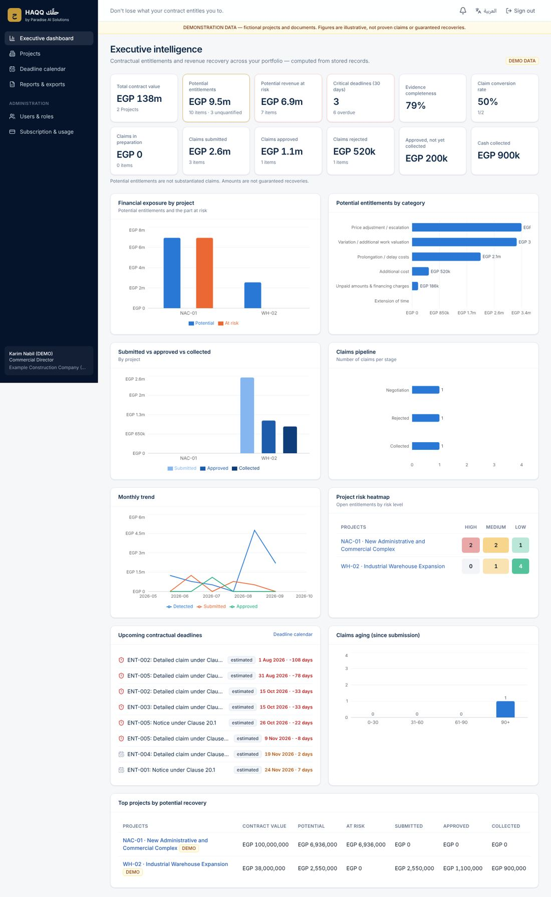
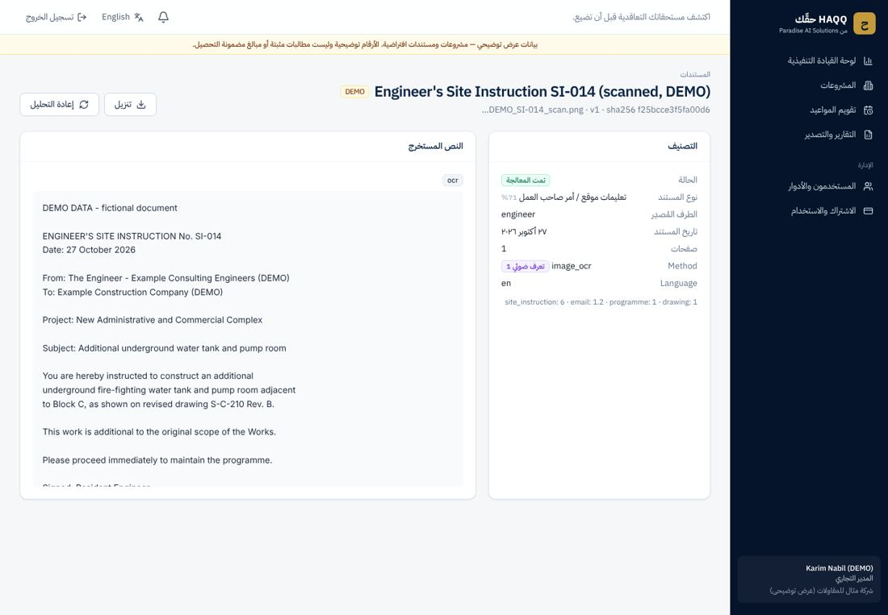
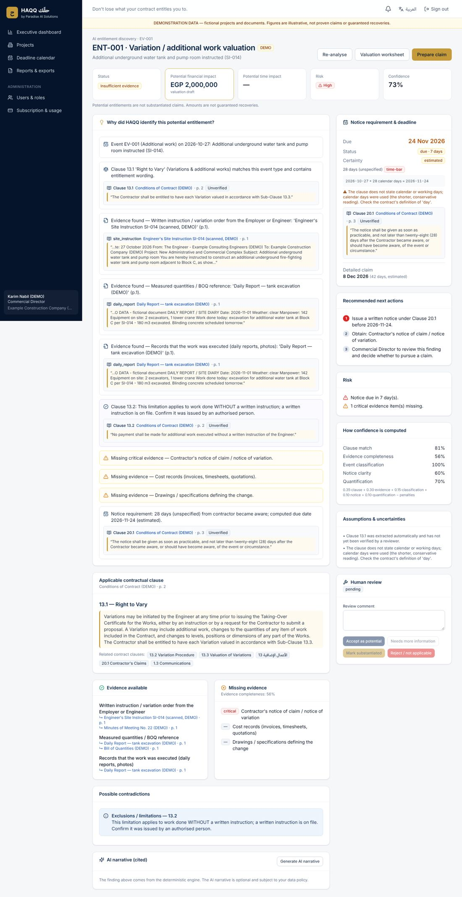

# HAQQ — User Guide

Switch language at any time with the **العربية / English** button (top bar). Arabic is right-to-left throughout,
including generated documents.

## 1. The journey
Each project's **Overview** shows the six steps and highlights the next one:
**Upload contract → Add project documents → Analyse → Discover entitlements → Review evidence → Prepare claim.**

## 2. Upload documents (Project → Documents)
Drop PDFs (including scans), photos, Word, Excel BOQs, e-mails (.eml) or text. Optionally set type, author party and
date (HAQQ detects them otherwise). Status moves *Queued → Processing → Processed*; scanned pages show an **OCR**
badge. A red shield means the file contains text that tries to instruct an AI — it is treated as data only.
Re-uploading a file with the same name creates a new version; identical files are refused.

## 3. Contract clauses (Project → Clauses)
Every clause shows number, title, document and **page**, category, time limits (red = time-bar), risk flags and the
verbatim text. Expand for rights, obligations, conditions and exclusions. Reviewers should **Mark verified** or
**Reject extraction** — verified clauses raise confidence. *Ask the contract* finds the most relevant clauses
(and, if your administrator enabled an AI model, answers with citations).

## 4. Events (Project → Events)
**Record event**: title, description, event date and — important for deadlines — the date your company became aware.
HAQQ suggests a category. Link the evidence (instructions, minutes, letters, daily reports, notices). On the event
page HAQQ suggests other related documents; they count as evidence only after you link them.

## 5. Discover entitlements
Click **Discover entitlements** on an event (or **Analyse all events**). For each potential entitlement read
**"Why did HAQQ identify this?"** — every line shows the clause or document and page with a quote. Check:
* **Status** — *Potential*, *Insufficient evidence*, *Requires expert verification* (HAQQ never marks a claim valid);
* **Missing evidence** (critical items first);
* **Notice requirement & deadline** with its certainty (*determined / estimated / ambiguous / undetermined*) and the
  exact calculation;
* **Recommended next actions**, risk factors and how confidence was computed.
The Commercial Director / reviewer records a decision with a comment: accept, needs information, reject, or
**substantiate** (requires a verified valuation and no missing critical evidence).

## 6. Valuation
**Valuation worksheet**: add lines manually or **Add from BOQ**, set quantities/rates and sources, optional
overheads/profit/VAT (flagged — only where the contract allows). *Calculate & save* shows every formula. A different
authorised user (e.g. CFO) must **Verify valuation**.

## 7. Claims
**Prepare claim** from an entitlement. Move it through the stages; some steps need specific roles (legal review →
management approval → submission). Generate a **notice letter**, **full claim package** (Word/PDF) or **valuation
worksheet** (Excel) in Arabic or English. Documents are drafts with a "not sent" banner and [VERIFY] markers — HAQQ
never sends anything to the employer; "Submitted" records that your company submitted it.

## 8. Deadlines
The **Deadline calendar** shows every contractual deadline (weekends shaded, Egypt Fri/Sat by default). Red =
overdue, amber = estimated/ambiguous. Mark deadlines complete when done. Alerts appear under the bell icon.

## 9. Executive dashboard
All figures come from stored records. Click any KPI to see the underlying entitlements, claims or deadlines.
Potential entitlements are not substantiated claims and are not guaranteed recoveries.
