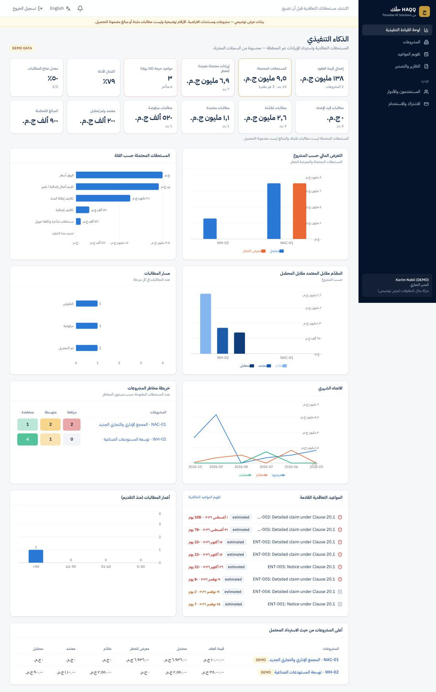
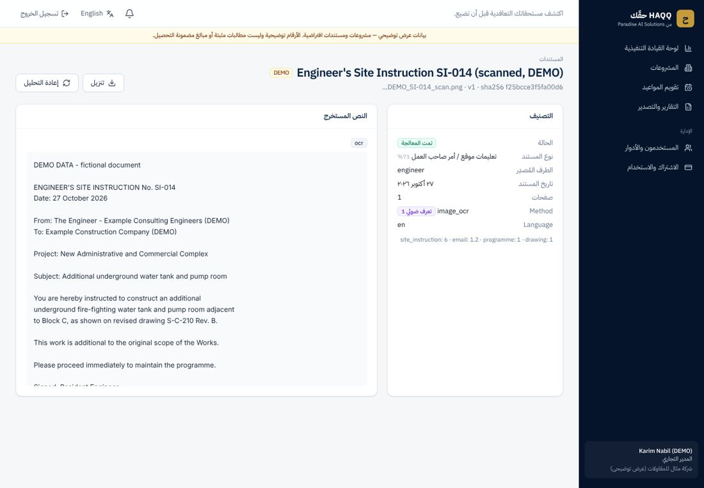
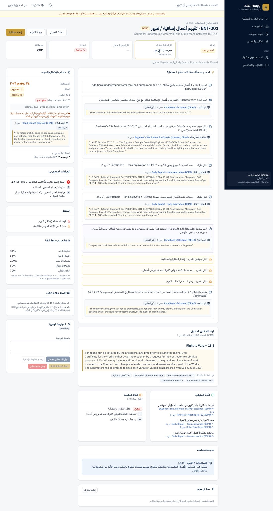
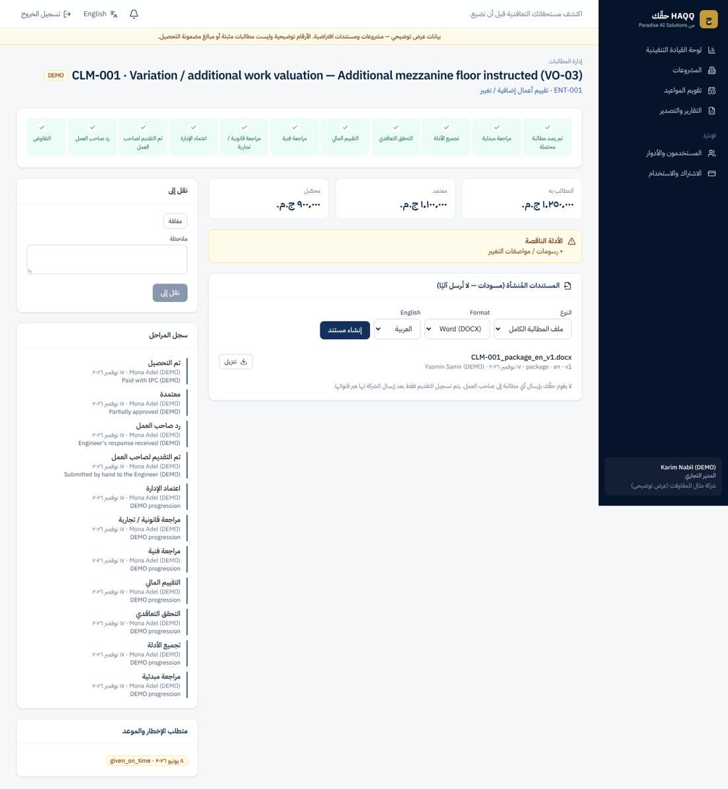

# حقّك — دليل المستخدم

يمكنك التبديل بين العربية والإنجليزية في أي وقت من زر **English / العربية** في الشريط العلوي. الواجهة العربية تعمل من اليمين
إلى اليسار بالكامل، وكذلك ملفات المطالبات التي تُنشئها المنصة.

> **تنبيه مهم:** ما ترصده المنصة هو **مستحقات محتملة**، وليست مطالبات مثبتة أو مبالغ مضمونة التحصيل. القرار النهائي دائماً
> لفريق الشركة، والمنصة لا ترسل أي مطالبة إلى صاحب العمل.

## 1. رحلة حماية الإيرادات
تعرض صفحة **نظرة عامة** في كل مشروع الخطوات الست، وتُبرز الخطوة التالية:
**رفع العقد ← إضافة مستندات المشروع ← التحليل ← اكتشاف المستحقات ← مراجعة الأدلة ← إعداد المطالبة.**

## 2. رفع المستندات (المشروع ← المستندات)
اسحب الملفات إلى المربع أو اضغط لاختيارها: ملفات PDF (بما فيها الممسوحة ضوئياً)، والصور، وملفات Word، وجداول الكميات في Excel،
ورسائل البريد الإلكتروني بصيغة ‎.eml‎، والملفات النصية. يمكنك تحديد نوع المستند والطرف المُصدِر والتاريخ، وإلا تحددها المنصة تلقائياً.
تتغير الحالة من *في الانتظار* إلى *قيد المعالجة* ثم *تمت المعالجة*، وتظهر علامة **تعرف ضوئي** على الصفحات الممسوحة.
علامة الدرع الحمراء تعني أن الملف يحتوي على نص يحاول توجيه الذكاء الاصطناعي، ويتم التعامل معه كبيانات فقط.
رفع ملف بنفس الاسم يُنشئ إصداراً جديداً، ورفع ملف مطابق تماماً يُرفض.

## 3. بنود العقد (المشروع ← البنود)
يظهر لكل بند رقمه وعنوانه والمستند و**رقم الصفحة**، وفئته، والمهل الزمنية (الأحمر يعني نص سقوط حق)، ومؤشرات المخاطر،
والنص الحرفي. افتح البند لترى الحقوق والالتزامات والشروط والاستثناءات. على المراجع أن يضغط **اعتماد البند** أو **رفض الاستخراج**،
فالبنود المعتمدة ترفع درجة الثقة في النتائج. وتعرض خانة **اسأل العقد** البنود الأكثر صلة بسؤالك (وإذا فعّل مدير النظام نموذج
ذكاء اصطناعي تأتي الإجابة مكتوبة مع الإشارة للمصادر).

## 4. الأحداث (المشروع ← الأحداث)
اضغط **تسجيل حدث**، واكتب العنوان والوصف وتاريخ الحدث، و— وهو مهم لحساب المواعيد — **تاريخ علم الشركة بالحدث**.
تقترح المنصة تصنيف الحدث. اربط به الأدلة: التعليمات، ومحاضر الاجتماعات، والخطابات، والتقارير اليومية، والإخطارات.
في صفحة الحدث تقترح المنصة مستندات أخرى ذات صلة، لكنها لا تُحتسب دليلاً إلا بعد أن تربطها بنفسك.

## 5. اكتشاف المستحقات
اضغط **اكتشاف المستحقات** في صفحة الحدث، أو **تحليل جميع الأحداث**. لكل مستحق محتمل اقرأ قسم
**"لماذا رصد حقّك هذا الاستحقاق المحتمل؟"**؛ كل سطر فيه يشير إلى البند أو المستند ورقم الصفحة مع اقتباس حرفي. وراجع:
* **الحالة**: *مستحق محتمل*، أو *أدلة غير كافية*، أو *يتطلب تحقق خبير*. المنصة لا تحكم أبداً بأن المطالبة صحيحة؛
* **الأدلة الناقصة** (الجوهرية أولاً)؛
* **متطلب الإخطار والموعد** مع درجة اليقين (*محدد / تقديري / غامض / غير محدد*) وطريقة الحساب بالتفصيل؛
* **الإجراءات الموصى بها**، وعوامل المخاطر، وطريقة حساب درجة الثقة.

يسجّل المدير التجاري أو المراجع قراره مع ملاحظة: قبول كاستحقاق محتمل، أو يحتاج معلومات إضافية، أو رفض، أو
**اعتماد كمطالبة مُثبتة** (ويتطلب ذلك تقييماً مالياً معتمداً وعدم وجود أدلة جوهرية ناقصة).

## 6. التقييم المالي
من **ورقة التقييم** أضف البنود يدوياً أو اضغط **إضافة من المقايسة**، وحدد الكميات والفئات والمصادر، ويمكنك إضافة مصروفات
عمومية وربح وضريبة (مع تنبيه بأنها تُسترد فقط إذا سمح العقد بذلك). زر **احسب واحفظ** يعرض كل معادلة.
ويجب أن يعتمد التقييم مستخدم مفوض آخر غير من أعدّه (مثل المدير المالي) بزر **اعتماد التقييم**.

## 7. المطالبات
اضغط **إعداد مطالبة** من صفحة المستحق، ثم انقلها بين المراحل؛ بعض المراحل تحتاج أدواراً محددة (المراجعة القانونية ← اعتماد الإدارة ←
التقديم). أنشئ **خطاب إخطار** أو **ملف المطالبة الكامل** (Word أو PDF) أو **ورقة التقييم** (Excel) بالعربية أو الإنجليزية.
كل المستندات مسودات تحمل تنبيه "لم تُرسل" وعلامات [يُتحقق منه]. المنصة لا ترسل شيئاً لصاحب العمل؛ ومرحلة "تم التقديم" تعني فقط
تسجيل أن الشركة قدّمت المطالبة عبر قنواتها.

## 8. المواعيد
يعرض **تقويم المواعيد** كل موعد تعاقدي، مع تظليل أيام العطلة (الجمعة والسبت افتراضياً في مصر). الأحمر يعني موعداً فائتاً، والبرتقالي
يعني موعداً تقديرياً أو غامضاً. اضغط **تم الإنجاز** عند الانتهاء. تظهر التنبيهات تحت أيقونة الجرس.

## 9. لوحة القيادة التنفيذية
كل الأرقام محسوبة من السجلات المخزنة. اضغط على أي مؤشر لترى المستحقات أو المطالبات أو المواعيد التي يتكون منها.

## 10. الأدوار والصلاحيات
| الدور | ما يمكنه عمله |
|---|---|
| الرئيس التنفيذي | لوحة القيادة، واعتماد تقديم المطالبات |
| المدير المالي | لوحة القيادة، واعتماد التقييمات، ومتابعة المعتمد والمحصّل |
| المدير التجاري | مراجعة المستحقات، وكل مراحل المطالبات |
| مدير العقود | البنود، والاكتشاف، والتقييم، وإعداد المطالبات، والمواعيد |
| مدير المشروع | مشروعاته فقط: الأحداث والأدلة والإجراءات |
| مهندس الموقع | مشروعاته فقط: رفع التقارير والصور وتسجيل الأحداث |
| المراجع القانوني | اعتماد البنود، والمراجعة القانونية، ومراجعة المستحقات |
| مدير النظام | المستخدمون، والإعدادات، وسياسة الذكاء الاصطناعي، وسجل التدقيق |
